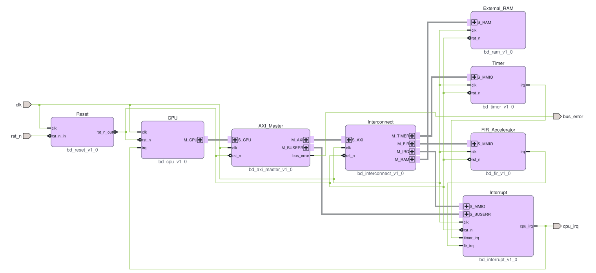

# Vivado Block Design của SoC FIR11

Thiết kế `soc_system` gom các bus thành interface, giữ nguyên CPU, FIR,
interconnect và giao thức MMIO của RTL gốc. Top do Vivado sinh ra là
`soc_system_wrapper`, có cùng bốn chân `clk`, `rst_n`, `cpu_irq`, `bus_error`.
`rtl/soc_top.v` vẫn là bản kết nối gốc để đối chiếu.



Ảnh trên được xuất bằng `write_bd_layout` từ Block Design thực tế.
Các cổng có dấu `+` cho phép mở xem từng tín hiệu trong Vivado.
Đây là thiết kế dùng cho mô phỏng/synthesis, không phải project chạy trên board.

## Tạo project và synthesis

Chạy tại gốc repo, với Vivado và bộ công cụ RISC-V đi kèm đã cài đặt:

```powershell
python scripts/run_block_design.py --vivado-root D:/vivado/2026.1/Vivado --cfg C --synth --diagram
```

- `--cfg A`: không có RAM ngoài, đáp ứng RAM được buộc về 0.
- `--cfg B`: RAM ngoài không cache.
- `--cfg C`: RAM ngoài có cache; đây là cấu hình synthesis chính.
- `--synth`: synthesis toàn bộ HDL của Block Design, không để IP black box.
- `--diagram`: mở tạm canvas GUI của Vivado để lưu bố cục và xuất SVG.
  Vivado không hỗ trợ xuất hình này trong chế độ batch thuần túy.
- `--output PATH`: chọn thư mục kết quả khác; mặc định
  `outfeed/block_design/<cfg>/`.

Mở `outfeed/block_design/C/project/soc_bd.xpr` bằng Vivado, rồi mở
`soc_system` trong **IP Integrator > Open Block Design** để xem/chỉnh vị trí.
Mỗi cấu hình được tạo trong project riêng. Chạy lại script sẽ tái tạo project;
mọi thay đổi cần giữ lâu dài phải được đưa vào script/metadata nguồn.

Các sản phẩm chính trong thư mục cấu hình:

| File | Nội dung |
|---|---|
| `project/soc_bd.xpr` | Project có Block Design để mở bằng GUI |
| `soc_system.svg` | Sơ đồ xuất thực tế khi dùng `--diagram` |
| `soc_system.layout` | Bố cục native do Vivado xuất |
| `simulation_sources.txt` | Danh sách HDL simulation của thiết kế sinh ra |
| `synthesis_sources.txt` | Danh sách HDL synthesis của thiết kế sinh ra |
| `post_synth.dcp` | Checkpoint toàn top sau synthesis |
| `util_synth*.txt` | Tài nguyên tổng và theo hierarchy |
| `timing_synth.txt`, `check_timing.txt`, `drc_synth.txt` | Báo cáo kiểm tra |
| `result.json`, `vivado.log`, `console.log` | Kết quả và log build |

`recreate_export.tcl` là bản xuất tham khảo của Vivado, không thay thế script
nguồn `fpga/bd/create_soc_bd.tcl`. Các file generated và đường dẫn máy trong
chúng ở thư mục được ignore, không cần đưa lên Git.

## Các source được thêm

| Source | Vai trò |
|---|---|
| `fpga/bd/create_soc_bd.tcl` | Đọc RTL, tạo các khối, nối bus/clock/reset/IRQ, Validate và sinh HDL |
| `fpga/bd/export_layout.tcl`, `soc_system.layout` | Bố trí và xuất sơ đồ trong GUI |
| `fpga/bd/interfaces/` | Bus definition và RTL abstraction IP-XACT của ba bus custom |
| `fpga/bd/rtl/` | Các wrapper nối dây có metadata interface |
| `scripts/run_block_design.py` | Build firmware, chạy Vivado, kiểm tra kết quả synthesis |
| `scripts/check_block_design.py` | Mô phỏng trên HDL Block Design thực tế, dùng scoreboard hiện có |
| `scripts/vivado_tools.py` | Môi trường và launcher cho các công cụ Vivado/XSim |

Các khối dùng **RTL Module Reference** của IP Integrator; không cần sao chép
logic gốc vào IP package. Các bus custom được khai báo trong IP repository
`fpga/bd/interfaces/`, còn metadata trên wrapper ánh xạ chân vào từng bus.

## Giao tiếp, clock và reset

- `M_CPU` / `S_CPU`, `M_RAM` / `S_RAM`: bus `soc_mem`, gồm
  `READ`, `WRITE`, `ADDR`, `WDATA`, `RDATA`, `READY`.
- `M_AXI` / `S_AXI`: AXI4-Lite giữ nguyên năm kênh AW/W/B/AR/R.
- `M_TIMER`, `M_FIR`, `M_IRQ` / `S_MMIO`: bus `soc_mmio`, gồm
  `WR_EN`, `RD_EN`, `WR_ADDR`, `RD_ADDR`, `WDATA`, `RDATA`.
  Đây vẫn là giao thức xung đọc/ghi hiện tại, không phải AXI slave.
- `M_BUSERR` / `S_BUSERR`: gom trạng thái lỗi AXI và đường xóa lỗi của CPU.
- Interconnect vẫn dùng chung `write_addr`, `read_addr`, `write_data` bên trong;
  wrapper chỉ đưa chúng ra từng nhóm, không chốt dữ liệu hoặc thêm độ trễ.
- Tất cả khối dùng chung `clk` 100 MHz. FIR wrapper và HLS `ap_clk`
  nối cùng nguồn này, không có PLL/chia clock hoặc miền clock mới.
- Khối Reset chứa `reset_sync` hai tầng, giữ cơ chế assert bất đồng bộ và
  release đồng bộ. Metadata liên kết reset đầu ra với clock để Vivado hiểu
  đúng sự đồng bộ này; không nối tắt bộ đồng bộ reset.
- CPU và interrupt controller vẫn nhận reset tích cực cao bằng đảo `rst_n_sync`.
  FIR HLS vẫn nhận `~rst_n | soft_rst_q` bên trong wrapper gốc.
- `ENABLE_EXT_RAM`, `EXT_RAM_USE_CACHE`, `EXT_RAM_TIMEOUT` và bản đồ thanh ghi
  tiếp tục có ý nghĩa như RTL gốc. `EXT_RAM_TIMEOUT` có thể chỉnh trong
  thuộc tính khối Interconnect; script mặc định giữ 1024 chu kỳ.

Address Editor hiển thị một vùng bus 1 GiB từ `0x00000000` tới interconnect.
Đây là metadata của kết nối AXI sau khi CPU bỏ hai bit địa chỉ cao, không
phải thêm bộ dịch địa chỉ. Việc chọn Timer/Interrupt/FIR/RAM vẫn do decoder
gốc thực hiện. Địa chỉ nhìn từ CPU giữ `0x40000080`, `0x400001C0`,
`0x40000200`, `0x40010000` tương ứng.

## Kiểm tra trên thiết kế mới

Tạo cấu hình trước khi chạy check tương ứng:

```powershell
python scripts/run_block_design.py --vivado-root D:/vivado/2026.1/Vivado --cfg A
python scripts/run_block_design.py --vivado-root D:/vivado/2026.1/Vivado --cfg B
python scripts/check_block_design.py --vivado-root D:/vivado/2026.1/Vivado --cfg A
python scripts/check_block_design.py --vivado-root D:/vivado/2026.1/Vivado --cfg B
python scripts/check_block_design.py --vivado-root D:/vivado/2026.1/Vivado --cfg C
```

Đối với B/C, mặc định chạy hai bài:

1. **application:** 1000 mẫu noise, scoreboard hiện có kiểm từng output FIR,
   IRQ, ngữ cảnh CPU, MMIO và RAM. Đồng thời chạy một `soc_top` gốc độc lập
   với cùng firmware/input, đối chiếu tín hiệu CPU/AXI/IRQ/RAM và PC
   theo từng chu kỳ. Nếu khác, simulation dừng bằng `$fatal`.
2. **fault:** scoreboard hiện có kiểm DECERR, SLVERR, thanh ghi BUSERR,
   timeout, phản hồi orphan và reset khi backend không trả lời.

A chạy smoke check elaboration/reset vì firmware chính cần RAM ngoài.
Có thể chạy thêm bài reset giữa giao dịch bằng `--tests reset` trên B/C.
Script chỉ thay đường dẫn hierarchy và kiểu DUT trong bản testbench sinh
ở output; không sửa các scoreboard nguồn trong `tb/`.

Kết quả, testbench đã ánh xạ, hash source/ảnh bộ nhớ và log nằm trong
`outfeed/block_design/<cfg>/checks/<test>/`. Bài application tạo firmware
và dữ liệu tương ứng từ đầu, không dùng nhầm header của dataset khác.

## Kết quả tham chiếu và log

Block Design A/B/C đã Validate thành công; 7 bài mô phỏng gồm elaboration/reset A,
application, fault và reset giữa giao dịch B/C đều PASS. Synthesis toàn top C
PASS, không ERROR, CRITICAL WARNING hoặc latch suy ra. Các bài application
đối chiếu theo chu kỳ với `soc_top` gốc dùng dataset noise.

Xem [kết quả và tài nguyên hiện tại](../README.md#11-kết-quả-kiểm-chứng).
Log synthesis trong `outfeed/block_design/C/`, log từng bài trong
`checks/<test>/simulate.log`. Project đã dựng lại từ output mới và kiểm tra
bố cục nằm tại `outfeed/block_design/clean_C/project/soc_bd.xpr`.

## Giới hạn

Synthesis thành công không có nghĩa đóng timing 100 MHz. Giữ constraint
clock gốc và đọc `timing_synth.txt` để xem kết quả thực tế. Không bắt buộc
place/route, bitstream, gán chân hay chạy board. RAM model chưa có cơ chế
nạp input trên phần cứng; synthesis chỉ kiểm netlist và bốn ảnh khởi tạo
IMEM/DMEM/FIR hiện có.
